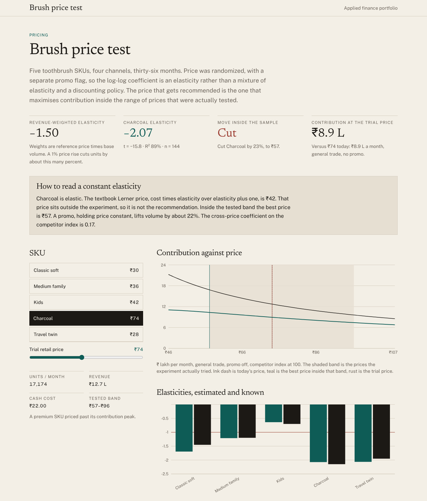

# Brush price test

Log-log price elasticities from a randomised toothbrush price experiment, and the contribution-maximising price inside the band that was actually tested. Five SKUs, four channels, thirty-six months, computed live in the browser.



**Live:** https://tanmayvasvani.github.io/brush-price-test/ · **Author:** Tanmay Vaswani

## What it does

A synthetic panel is generated in which retail price was randomised around each SKU's reference price, with a separate promo flag, a competitor price index, channel effects and seasonality. Because price was assigned rather than chosen, the log-log coefficient is a clean own-price elasticity rather than a mixture of elasticity and the firm's discounting policy.

For each SKU the page shows:

- **The estimated elasticity** with its standard error, t-statistic, R² and n, beside the elasticity that generated the data (known only because the panel is synthetic).
- **A decision:** raise, cut or hold, with the best price inside the tested band and the gain in monthly contribution.
- **The contribution and revenue curves** against price, with the tested band shaded and today's price, the recommended price and a movable trial price marked.
- **The full regression table** (intercept, ln price, promo, ln competitor, channel dummies, season).
- **A revenue-weighted elasticity** across the line (−1.50 in the base panel).

The Lerner price, cost × e / (e + 1), is reported only as a check. Where demand is inelastic (Kids, e ≈ −0.7) a higher price should be tested rather than an optimum invented; where the Lerner price falls outside the experiment (Charcoal, e ≈ −2.1) the recommendation stays inside the tested band.

## Method

- Panel: SKU × channel × month. ln(quantity) = ln(base) + e·ln(price/reference) + 0.16·promo + 0.22·ln(competitor index/100) + channel shift + seasonal sine + Gaussian noise.
- Each SKU is fit on its own by OLS of log units on log price, the promo dummy, log competitor index, three channel dummies and a seasonal sine. General trade is the omitted channel.
- The decision curve holds the dummies at the general-trade, no-promo, competitor-at-100 cell and uses the estimated intercept and slope, never the true elasticity.
- Contribution is (price − cash cost) × quantity, maximised by grid search between the minimum and maximum price observed for the SKU.

## Checks

`npm test` runs 31 assertions, including: the panel has the right shape and prices are randomised around each reference; every known elasticity is recovered within sampling error with |t| > 3; the promo lift is recovered; the reference cell lands near the base volume; recommendations never leave the tested band and the direction follows a ±3% dead band; the Lerner price is reported only when demand is elastic; the inelastic SKU is told to raise and the over-priced premium SKU to cut; and the shared statistics kit matches reference values.

## Run it locally

```bash
npm install
npm run dev        # http://localhost:5173
npm test           # vitest
npm run build      # typecheck + static build into dist/
```

Requires Node 20 or newer.

## Deploy

The build is a static site (`dist/`) with relative asset paths, so it works on Vercel, Netlify, Cloudflare Pages or GitHub Pages with no configuration beyond "build command `npm run build`, output directory `dist`".

## Stack

React 19, TypeScript (strict, `noUncheckedIndexedAccess`), Vite, Tailwind CSS 4, Recharts, Vitest. OLS, the seeded PRNG and the normal draws are in `src/lib/stats.ts` with no dependencies.

## Data

The panel is synthetic and computed in the browser. Prices were randomised in the experiment.

## License

MIT
